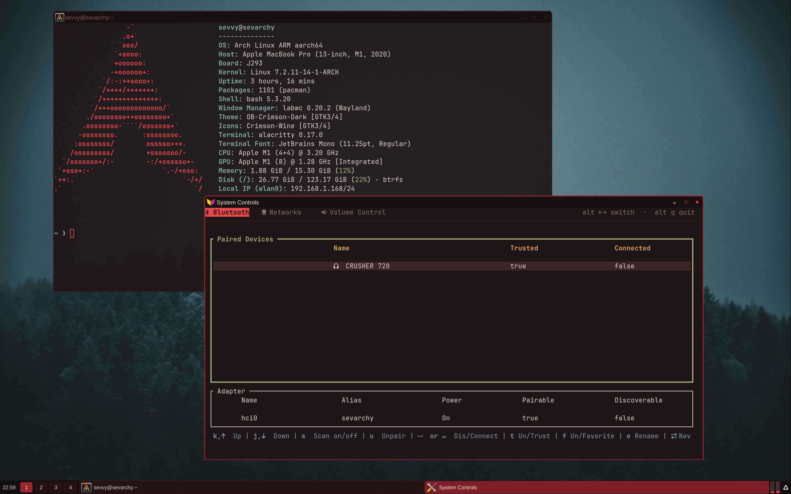

# dotfiles

labwc + sfwbar + fuzzel + alacritty, themed **Crimson Dark** throughout (window
chrome, terminal, launcher, bar, notifications, Firefox, Nautilus, Mousepad,
galculator, Clocks, lock screen and every other GTK app, LibreOffice
included), with terminal apps for volume, Bluetooth and network.
Built on Fedora Asahi Remix; installs on Fedora,
Arch (including CachyOS) and Debian/Ubuntu, from a minimal TTY-only install
or alongside an existing desktop.

## Quick start

Works on x86 or ARM, on Debian, Ubuntu, Arch, CachyOS and Fedora.

Before you start, copy the wallpaper you want to `~/Pictures/wallpaper.png`.
labwc picks it up when it launches, so you won't have to exit and re-launch
it later to get your wallpaper.

Clone the repo into a `dotfiles` folder in your home directory:

```sh
git clone https://github.com/Sevvy77/LabwcDotfiles ~/dotfiles
```

Move into your new dotfiles directory:

```sh
cd ~/dotfiles
```

Run the automated package installer. Use `--dry-run` first if you'd like to
see what it will install before anything changes:

```sh
./install-packages.sh --dry-run
```

then:

```sh
./install-packages.sh
```

Run the installer script to apply my configs and theming:

```sh
./install.sh
```

Launch labwc:

```sh
labwc
```

Exit labwc from a shell with `labwc --exit`, click on empty desktop space
and choose Exit from the menu that pops up, or press Ctrl+Alt+Delete.

## Layout

Each top-level directory holds config files laid out relative to `$HOME`,
which `install.sh` copies into place:

```
labwc/.config/labwc/{environment,autostart,rc.xml}
sfwbar/.config/sfwbar/sfwbar.config
fuzzel/.config/fuzzel/fuzzel.ini
alacritty/.config/alacritty/alacritty.toml
mako/.config/mako/config                           # notifications (crimson border; red for critical)
wiremix/.config/wiremix/wiremix.toml               # Volume Control (wiremix) colours
zellij/.config/zellij/system-controls.kdl          # System Controls: zellij settings, Alt keys, Crimson theme
zellij/.config/zellij/layouts/system-controls.kdl  # its three tabs and the zjstatus tab bar
zellij/.config/zellij/layouts/zjstatus-permissions.kdl  # one-off screen for allowing zjstatus
tuimenu/.config/tuimenu/list.json                  # tuimenu's list of programs
bin/.local/bin/audio-scope                         # scope-tui on whatever output is playing
bin/.local/bin/system-controls                     # opens System Controls (Super+o)
themes/.local/share/icons/Crimson-Wine/index.theme   # red GNOME-Colors Wine icons + Adwaita fallbacks
themes/.local/share/themes/OB-Crimson-Dark/
  labwc/themerc        # window theme
  gtk-3.0/gtk.css      # every GTK3 app (Mousepad, galculator, LibreOffice, gtklock)
  gtk-4.0/gtk.css      # plain (non-libadwaita) GTK4 apps (generated, see scripts/)
  gtk-4.0/gtk-dark.css # imports gtk.css; GTK4 loads it when dark is preferred
gtk3/.config/gtk-3.0/settings.ini                  # GTK theme = OB-Crimson-Dark, prefer dark
gtklock/.config/gtklock/style.css                  # lock screen wallpaper (fills portrait screens too)
gtk4/.config/gtk-4.0/settings.ini                  # same, for GTK4
gtk4/.config/gtk-4.0/gtk.css                       # libadwaita apps in dark mode (Nautilus, Clocks)
gtksourceview/.local/share/gtksourceview-4/styles/crimson-dark.xml   # Mousepad editor
dbus/.local/share/dbus-1/services/org.gnome.Nautilus.service         # dark Nautilus when D-Bus-started
dbus/.local/share/dbus-1/services/org.gnome.clocks.service           # dark Clocks when D-Bus-started (alarms)
applications/.local/share/applications/*.desktop   # theme overrides + launchers for the terminal apps
bash/.bashrc.d/crimson-dotfiles.sh   # fastfetch, ~/.local/bin on PATH (sourced from your ~/.bashrc)
install-packages.sh   # installs the software (dnf, pacman+AUR, or apt; sfwbar from source on apt,
                      # the terminal apps with cargo where they aren't packaged)
install.sh
update.sh             # pull from GitHub, then install over your configs (install.sh --force)
```

Handled separately by `install.sh`:

```
firefox/chrome/{userChrome,userContent}.css, firefox/user.js   # copied/merged into the default profile
scripts/gen-gtk4-crimson.py   # regenerates gtk-4.0/gtk.css from GTK's own stylesheet (not installed)
src/tuimenu/                  # tuimenu restyled in Crimson Dark, built with cargo into ~/.local/bin
```

plus galculator's display colours (written into `galculator.conf`),
zjstatus for System Controls (downloaded, see below),
Mousepad's `crimson-dark` colour scheme, and the global GTK theme and dark
style (`org.gnome.desktop.interface` gtk-theme / color-scheme; all set with
`gsettings`, which is what GTK reads on Wayland).

## Terminal apps

Volume, Bluetooth, network and an audio scope are terminal (TUI) apps written in
Rust rather than GTK windows. Open them from the launcher (Super+k) by name;
each comes up in its own opaque alacritty window. Super+o opens the first
three together, as tabs (see System Controls below):

| Launcher name  | App            | Replaces            |
|----------------|----------------|---------------------|
| Volume Control | wiremix        | pavucontrol         |
| Bluetooth      | bluetui        | Blueman             |
| Network        | nmrs-tui       | nm-applet / nmtui   |
| Audio Scope    | scope-tui      | (new)               |

Each window has its own class (`crimson-volume`, `crimson-bluetooth`,
`crimson-network`, `crimson-scope`) for labwc window rules. wiremix gets Crimson colours
from its config file. bluetui and nmrs-tui use the terminal's palette,
which is already Crimson Dark. nmrs-tui 0.1.1 can't read a config file (see
Known gaps).

Audio Scope runs `~/.local/bin/audio-scope`, which starts scope-tui on the
output that's playing: the one the newest playing stream goes to on Volume
Control's Playback tab, or the default output if nothing is playing. It
chooses when it starts, so reopen it after moving playback to another
output. Options after `audio-scope` go to scope-tui (e.g. `--scatter`). In
the scope: Tab cycles oscilloscope, vectorscope and spectrum; Up/Down zoom;
Left/Right change the time span; Space pauses; `s` toggles scatter; `h`
hides the labels; Esc resets; `q` quits.

### System Controls (Super+o)

Super+o (or "System Controls" in the launcher) opens Bluetooth, Networks
and Volume Control together, as tabs of one [zellij](https://zellij.dev)
session in an alacritty window of class `crimson-controls`. All three keep
running while you switch:

| Keys                       | Does                         |
|----------------------------|------------------------------|
| Alt+←/→, Alt+h/l, or click | previous / next tab          |
| Alt+1, Alt+2, Alt+3        | Bluetooth, Networks, Volume  |
| Alt+q, or close the window | quit all three               |

zellij starts locked, so every other key goes to the app. Quitting an app
leaves its tab open; Enter starts it again. Ctrl+g unlocks zellij's own
keys. The setup has its own config (`system-controls.kdl`), so it doesn't
affect zellij's default `config.kdl` if you use zellij for other things.

The tab bar is [zjstatus](https://github.com/dj95/zjstatus), a zellij
plugin, because zellij's own tab bar can't hide the session name, the "+"
button or its "running" counter. `install.sh` downloads a pinned release to
`~/.config/zellij/plugins/` and checks its sha256. zellij makes you allow a
plugin before it runs, and the prompt can't take keys inside the tabs
(they go to the app), so the first time, `system-controls` opens zjstatus
on a screen of its own: press `y`, then Alt+q, and the tabs open. The same
happens after an update brings a new zjstatus. The tab icons are Nerd Font
glyphs, which alacritty takes from any installed Nerd Font (on Arch,
`install-packages.sh` installs the symbols-only one).

### tuimenu

`tuimenu` is a small menu for launching terminal programs, listed in
`~/.config/tuimenu/list.json` (arrows or j/k, Enter, q). It's built from
`src/tuimenu`, a copy of tuimenu 0.0.2 restyled in Crimson Dark (see its
README for the changes), not installed from crates.io, which would give the
unstyled version.

## Install

```sh
git clone https://github.com/Sevvy77/LabwcDotfiles.git ~/dotfiles
cd ~/dotfiles
./install-packages.sh   # the software, as your normal user (uses sudo)
./install.sh            # the config files
labwc                   # from a TTY; or pick "labwc" in GDM/SDDM
```

That works from a minimal install with nothing but a TTY. You need `git`
to clone, and `sudo` for your user (or run `install-packages.sh` as root and
`install.sh` as your user; the script explains how to set up sudo if it's
missing).

### install-packages.sh

Works on Fedora, Arch and Debian/Ubuntu. It has one table mapping each
package to its name on each distro, checks every name before installing,
and lists anything it can't find instead of failing. Besides the desktop's
own programs it installs what a minimal system lacks: graphics drivers,
PipeWire audio, bluetooth, a polkit agent for password prompts, fonts and
icons. It then enables bluetooth and the PipeWire user services.

The bar, `sfwbar`, isn't packaged everywhere. On Arch it comes from the
AUR: with `yay` or `paru` if you have one, otherwise the script builds it
with `makepkg`. On Debian and Ubuntu it's built from source (the version
this config was written for) and installed to `/usr/local`.

The terminal apps (wiremix, bluetui, nmrs-tui, scope-tui, and zellij for
System Controls) are in Arch's repos, apart from nmrs-tui and scope-tui,
which come from the AUR. Where your
distro doesn't package one, the script builds it with `cargo install` into
`~/.local/bin`, and installs cargo and the libraries it needs first. nmrs-tui
needs Rust 1.96 or newer; if your distro's is older, the script says so, and
[rustup](https://rustup.rs) gets you a current one. If there's no cargo at
all, it installs your distro's Rust, which `install.sh` uses to build
tuimenu (an existing rustup is left alone).

Options: `--dry-run` shows what it would do, `--yes` doesn't ask to
confirm, `--skip vlc,libreoffice` leaves packages out.

On Ubuntu, Firefox and Chromium are snaps. Ubuntu's snap Firefox is
supported, but it can't read hidden directories in `$HOME`, so clone this
repo somewhere like `~/dotfiles`, not `~/.dotfiles`.

### install.sh

Copies every config file into `$HOME`, applies the theme pieces that aren't plain files
(`galculator`, `mousepad`, `firefox`), downloads zjstatus for System
Controls (`zjstatus`), builds tuimenu from `src/tuimenu` with cargo
(`tuimenu-build`; only again when that source changes), creates `~/Pictures`, refreshes the
desktop database and reloads the D-Bus session config. Pass names to install
a subset, e.g. `./install.sh alacritty bash firefox`, and `--verbose` to see
what happened to every file.

The installed files are copies, not links into this repo: once installed,
they're yours to edit, and the repo stays clean. It is safe to re-run (for
example after `git pull`). The script remembers which version of each file
it installed (in `~/.local/state/crimson-dotfiles/`), and on a re-run:

- files you haven't changed are updated to the repo's current version;
- files you have changed are left alone. If the repo's version has changed
  too, it's written beside yours as `<file>.new` and listed at the end, so
  you can compare and merge (`diff`), then delete the `.new`;
- files that were already there before the first install are treated the
  same way: never overwritten, with the repo's version as `.new`.

`--force` replaces files that differ with the repo's version, keeping yours
as `<file>.bak`.

Your `~/.bashrc` is never replaced. The repo's bash settings live in
`~/.bashrc.d/crimson-dotfiles.sh`, and `install.sh` adds one line to the end
of `~/.bashrc` that sources it (once; re-runs don't add it again). If an
earlier version of the script had replaced your `.bashrc` and moved the
distro's to `~/.bashrc.skel`, the distro's is put back.

Installs made by earlier versions of this script symlinked files into the
repo; a re-run replaces those symlinks with copies. Files an earlier version
installed that the repo has since dropped (such as the pavucontrol, Blueman
and Spotify web launchers) are removed, unless you've edited them.

Firefox needs a profile to exist first (start and quit it once, then run
`./install.sh firefox`), and a restart to pick up the stylesheets. galculator
must be closed while its colours are written.

### update.sh

Gets the latest version from GitHub and installs it over your config files,
replacing any that differ from the repo (your changed copies are kept as
`<file>.bak`). It's `git pull --ff-only` then `./install.sh --force`, and
takes the same names and `--verbose`. Without git (e.g. a copy from the
.zip), it downloads the repo with curl or wget instead. Works on Fedora,
Arch, CachyOS, Debian and Ubuntu.

Use `./install.sh` after `git pull` instead if you'd rather keep your
changes and merge the repo's `.new` versions yourself.

### Your own changes

- Wallpaper: `~/Pictures/wallpaper.png` if it exists (desktop and lock
  screen), otherwise the theme's background colour.
- Anything specific to one machine (a different monitor setup, the bar on
  one screen only, keybindings): edit the installed files in `~/.config`
  directly.
- Display scaling and other startup commands can also go in
  `~/.config/labwc/autostart.local`, which `autostart` runs and which the
  repo doesn't ship, so repo updates to `autostart` still apply cleanly.
  For example: `wlr-randr --output eDP-1 --scale 1.4`

## Known gaps

- The theme for plain GTK4 apps is generated from GTK 4.22's built-in
  stylesheet. After a GTK4 upgrade, re-run `scripts/gen-gtk4-crimson.py`
  (needs `python3-gobject`), as `install.sh` reminds you.
- nmrs-tui 0.1.1 ignores its config file: it reads it through `ron::Value`,
  which drops enum names such as `Thick`, so loading always fails and it
  quietly uses its built-in settings. Its defaults use the terminal's yellow
  and green, which suit Crimson Dark.
- bluetui's colours are fixed in its code (focused panes get a green
  border); it only follows the terminal palette.
- Fedora, Debian and Ubuntu don't package a Nerd Font, so System
  Controls' tab icons show as boxes there until you install one (any
  [Nerd Font](https://www.nerdfonts.com), e.g. Symbols Only, in
  `~/.local/share/fonts`).
- Web pages keep their own colours; Dark Reader (a browser extension, not in
  this repo) darkens them.
- `bluez`, `network-module` and `volume` sfwbar widgets are commented out —
  re-enabling them on `sfwbar 1.0~beta16` deadlocks the bar (see the config
  file for the full explanation).
- No idle/lock daemon; add one to `autostart` if you want it. `mako`
  (notifications) isn't in `autostart` either: D-Bus starts it on the first
  notification.

## License

GPL-3.0; see [`LICENSE`](LICENSE).

Started from [antomfdez/LabwcDots](https://github.com/antomfdez/LabwcDots)
(GPL-3.0). The bar config and window theme have since been rewritten from
scratch; the alacritty config keeps its general shape.
